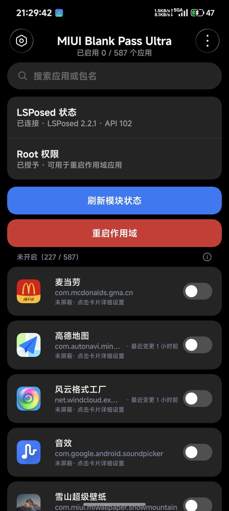
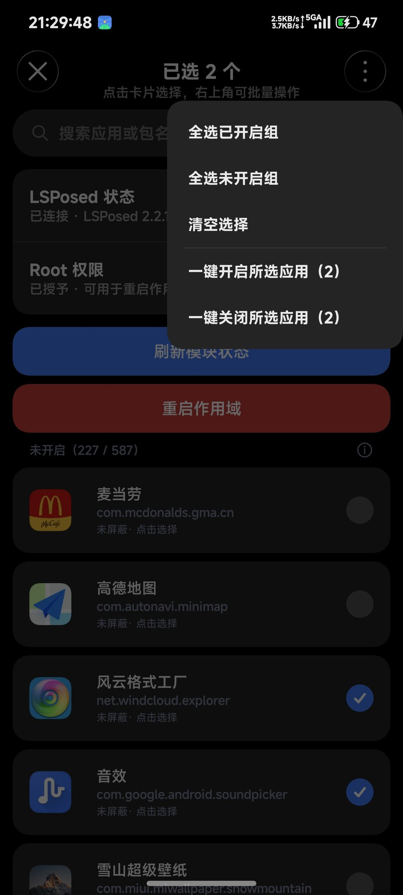
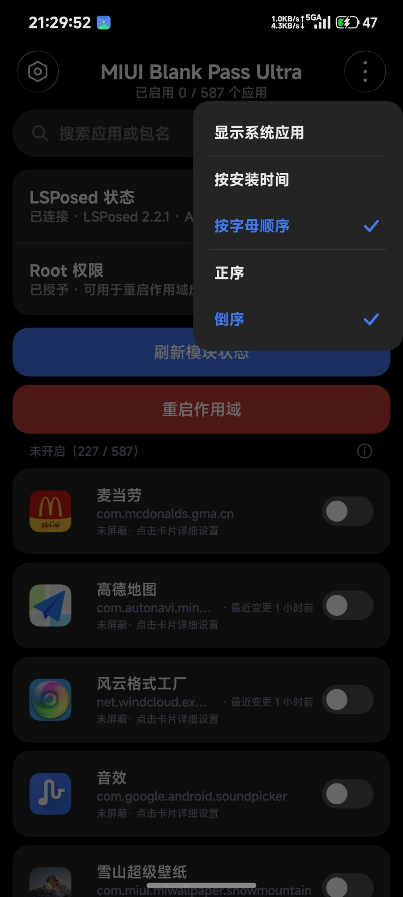
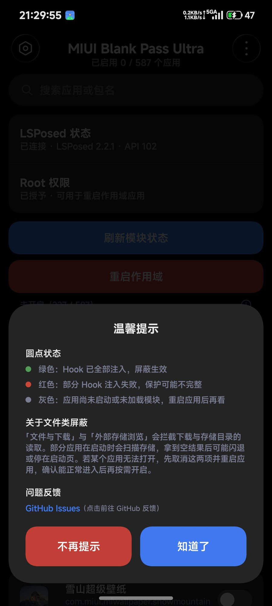
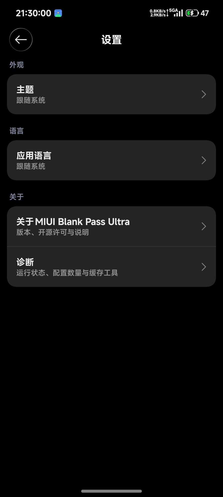
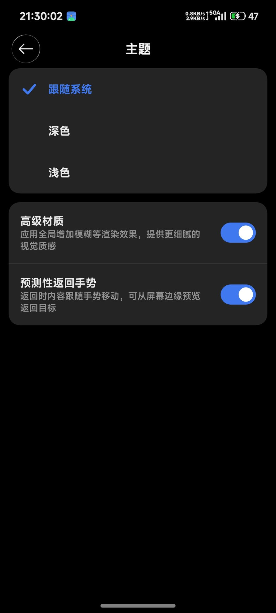
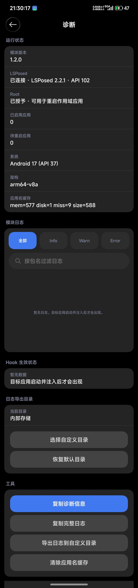
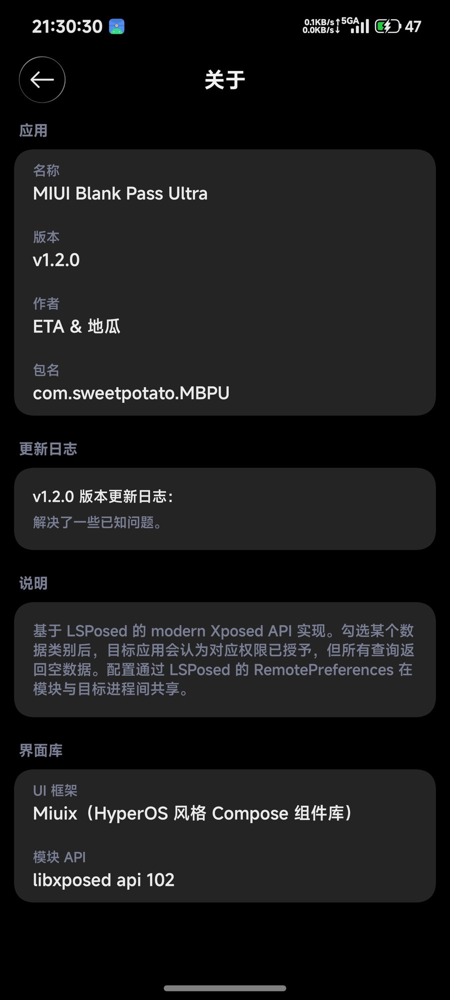

# MIUI Blank Pass Ultra（空值权限）

基于 LSPosed 的 modern Xposed API 模块：勾选的权限类别，目标应用会认为「已授权」，但所有查询都拿到空数据。

不是权限管理，也不是拒绝授权——是真授权、假数据。对应用来说权限状态一切正常，只是通讯录空了、相册空了、剪贴板空了、相机打不开了。

## 功能

| 类别 | 效果 |
| --- | --- |
| 通讯录 | 权限视为已授予，查询返回空列表 |
| 短信 | 权限视为已授予，查询返回空列表 |
| 通话记录 | 权限视为已授予，查询返回空列表 |
| 日历 | 权限视为已授予，查询返回空列表 |
| 相册媒体 | 媒体权限视为已授予，图片 / 视频 / 音频返回空 |
| 文件与下载 | 存储权限视为已授予，下载目录与文档查询返回空 |
| 外部存储浏览 | 应用列不出外部存储目录 |
| 定位 | 权限视为已授予，但返回空值且不再上报位置 |
| 剪贴板 | 读取剪贴板返回空 |
| 设备标识 | 电话状态权限视为已授予，IMEI / IMSI / 序列号返回空 |
| 应用列表 | 应用列表权限视为已授予，查询返回空 |
| 账户 | 账户权限视为已授予，系统账户列表返回空 |
| 麦克风 | 录音权限视为已授予，录到的数据全为零（静音） |
| 相机 | 相机权限视为已授予，但打开相机失败、不返回画面 |

界面部分：

- Miuix（HyperOS 风格 Compose 组件库）实现，深浅色跟随系统，支持高级材质（玻璃 / 模糊）
- 单应用精细开关 + 批量开启 / 关闭，自动向 LSPosed 申请作用域
- 每张卡片带 Hook 状态圆点：绿 = 全部注入，红 = 部分失败，灰 = 尚未注入
- 诊断页：运行状态、配置数量、按包名 / 级别筛选模块日志、一键导出到系统下载目录或自定义目录
- 20 种语言：简体中文、繁体中文（香港 / 台湾）、维吾尔语、藏语、英语（US / GB）、法语、德语、意大利语、土耳其语、荷兰语、俄语、西班牙语（ES / 拉美）、葡萄牙语（PT / BR）、阿拉伯语（RTL）、日语、韩语

## 截图

<table>
<tr>
<td></td>
<td></td>
<td></td>
<td></td>
</tr>
<tr>
<td align="center">主页</td>
<td align="center">批量选择</td>
<td align="center">排序与系统应用</td>
<td align="center">温馨提示</td>
</tr>
<tr>
<td></td>
<td></td>
<td></td>
<td></td>
</tr>
<tr>
<td align="center">设置</td>
<td align="center">主题与高级材质</td>
<td align="center">诊断</td>
<td align="center">关于</td>
</tr>
</table>

## 环境要求

- Android 10 及以上（minSdk 29，targetSdk 37）
- LSPosed（modern Xposed API，`minApiVersion=101`、`targetApiVersion=102`）
- Root 只在诊断页读取模块日志时需要，模块本体不需要

## 使用

1. 安装 APK
2. 在 LSPosed 里启用「MIUI Blank Pass Ultra」，勾选需要生效的应用
3. 打开模块，选中应用 → 勾选要屏蔽的类别（模块会自动写入作用域）
4. 强制停止并重新打开目标应用

关闭类别后 hook 不会立刻卸载，需要重启目标应用；卡片和批量操作里都会提示。

## 构建

需要 JDK 17 与 Android SDK 37。构建脚本会自动找 `gradle`，也可以 `GRADLE_BIN=/path/to/gradle ./build.sh`。

```bash
cp local.properties.example local.properties   # 填入 sdk.dir 与签名信息
./build_native.sh                              # 可选：仓库已带编译好的 so
./build.sh                                     # 产出 app/build/outputs/apk/release/app-release.apk
```

几个不算常规的细节：

- native 安全层用系统 clang + NDK sysroot 手动交叉编译（`build_native.sh`），因为官方 NDK 的 `ndk-build` / `cmake` 依赖 x86_64 host 工具
- 签名信息全部来自 `local.properties`，仓库里没有任何 keystore 和密码
- 没配签名时 `assembleDebug` 仍可正常出未签名包
- `./build.sh debug` 出未优化的 debug 包，只用来排查问题；Compose 在 debug 下滚动会明显掉帧
- **aarch64 机器上必须指定 aapt2**：SDK 自带的 aapt2 是 x86-64 二进制，直接跑会报 `Daemon startup failed`。两条路：用 ARM 原生版本，或用 qemu 包装

```bash
# 方案一：ARM 原生 aapt2（推荐，无需翻译层）
AAPT2_OVERRIDE=/path/to/arm64/aapt2 ./build.sh

# 方案二：qemu 包装 SDK 自带的那份
printf '#!/bin/sh\nexec /usr/bin/qemu-x86_64 -L /usr/x86_64-linux-gnu %s "$@"\n' \
    "$ANDROID_HOME/build-tools/36.0.0/aapt2" > /tmp/aapt2-wrap
chmod +x /tmp/aapt2-wrap
AAPT2_OVERRIDE=/tmp/aapt2-wrap ./build.sh
```

脚本会自动加 `-Pandroid.aapt2FromMavenOverride=<指定路径>`，不需要改 `gradle.properties`。

## 签名校验

期望值从 `local.properties` 的 `EXPECTED_SIG_SHA256` 注入，**不写进源码**。留空 = 不校验，适合自己编译调试；填了 = 严格校验。

校验分两层，因为模块的代码会跑在两类完全不同的进程里：

**1. 模块自己的界面进程**（`App.onCreate` → `Security.verify`）
签名不符直接结束进程。这一层拦住的是「装了个假界面」。

**2. 目标应用进程**（`PermNullModule.install` → `ModuleIntegrity`）
hook 代码被框架注入到别的应用进程里，不会经过 `App.onCreate`，上面那层覆盖不到这里。所以在真正安装 hook 之前，再核对一次承载模块代码的 APK 签名：

- 通过 `getModuleApplicationInfo()` 拿到框架实际加载的那份 APK 路径
- 用 `PackageManager.getPackageArchiveInfo` 取出签名证书，算 SHA-256 比对
- 每个进程只算一次，结果缓存，后续不产生开销
- **不匹配就跳过安装**，不装任何 hook，也绝不终止目标进程

这层的意义是：重打包产物能装、能打开界面，但对任何目标应用都不生效，等于空壳。

取值方式（keystore 需自行生成，仓库不含任何 keystore 与密码）：

```bash
keytool -list -v -keystore <你的.keystore> -alias <别名> | grep SHA256
```

对应 native 层只负责比对，自身不烧任何哈希。

## 官方包指纹

官方发布的 APK 由固定证书签名，证书 SHA-256 为：

```
ebe065a95b248ca8e9d98a4f8e4a9e3877b30e1a3b61833e9a34cf41c29dc0d0
```

安装前可以自己核对拿到的包是不是这个证书签的：

```bash
apksigner verify --print-certs 你的包.apk
```

看输出里的 `Signer #1 certificate SHA-256 digest` 是否一致。不一致就是别人改过重签的版本，不要装。

从源码自行编译的包签名必然不同，那是正常的——这类包在 `EXPECTED_SIG_SHA256` 留空时不做任何校验，只在你自己填了期望值时才按你的证书校验。

这条公示挡不住有备而来的伪造者，但能让「假包冒充官方包」这件事当场暴露。

## 目录结构

```
app/src/main/java/io/github/sweetpotato_digua/mbpu/     Hook、配置、Root、安全校验（Java）
app/src/main/kotlin/io/github/sweetpotato_digua/mbpu/   Compose UI（Miuix）
app/src/main/cpp/security.c                 native 安全层：反调试 + 签名比对 + 反注入
app/src/main/jniLibs/                       预编译 native 产物（arm64-v8a / armeabi-v7a / x86_64）
app/src/main/res/values*/strings.xml        20 种语言
app/src/main/resources/META-INF/xposed/     modern Xposed 模块声明
docs/screenshots/                           README 引用的界面截图
build.sh / build_native.sh                  构建脚本
```

## 已知限制

- 「文件与下载」「外部存储浏览」「相册媒体」是文件 / URI 级拦截。对已经拿到真实存储权限的应用，系统 fuse 层仍可能放行部分路径，屏蔽完整性不如系统级权限撤销
- 部分应用启动时会扫描存储，拿到空结果后可能闪退或停在启动页（应用内「温馨提示」有说明）
- `ContentProviderClient.call(String method, String arg, Bundle)` 这类拿不到 authority 的三参调用未拦截
- `MediaRecorder` 录音链路未 hook，只覆盖了 `AudioRecord`
- 不带 authority 的 `applyBatch` 命中时按整批伪成功处理，混合批次会吞掉自有 provider 的写入
- 卸载应用后配置残留不会自动清理，重装同包名会继承旧配置

## 免责声明

仅供学习与个人隐私保护使用，请勿用于规避应用的风控、付费或授权机制。使用本模块造成的一切后果由使用者自行承担。

## 许可证

[PolyForm Strict 1.0.0](LICENSE)

允许你做的：个人研究、实验、测试、学习、私人娱乐、业余爱好项目，以及慈善、教育、公共研究、公共安全与卫生、环保、政府机构的使用。

不允许的：**分发这个软件**、**修改它或基于它做衍生作品**、以及**任何商业用途**。这不是 OSI 定义的开源许可证——它比常见的开源许可严格得多，请按「可以自己用，不能改、不能传、不能卖」来理解。

需要修改或再分发请先联系作者取得书面授权。

作者：ETA & 地瓜
